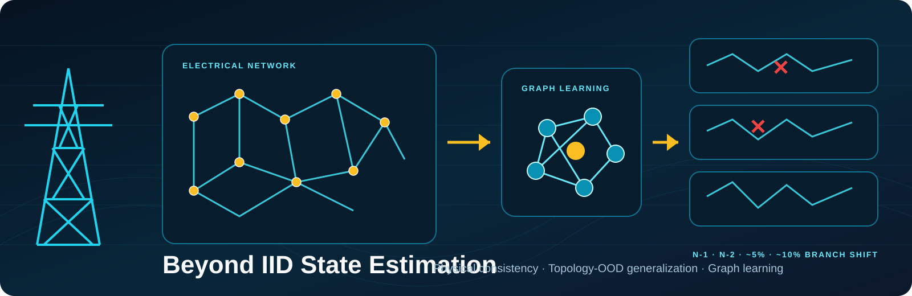

<div align="center">

# Beyond IID State Estimation
### Physical Consistency and Topology-Shift Generalization in Graph Neural Networks for Power Systems

**Gitesh Malik · Delhi Technological University**  
**NeurIPS 2026 Workshop — Physical Understanding for Decision-Making**

[](https://openreview.net/forum?id=4P0jM8lxua)
[](#)
[](LICENSE)

**Can a state estimator trained on one electrical network remain reliable when the network topology changes?**

A paper-aligned benchmark study of power-system state estimation (PSSE) under strict topology-disjoint distribution shift. The study compares a common-information weighted least-squares reference with MLP and graph-neural estimators, then tests whether a lightweight measurement-physics penalty changes OOD degradation.

</div>

<p align="center">
  
</p>

> **Research integrity / implementation status.** This repository contains the workshop paper link, a detailed protocol and methodology record, paper-reported aggregate tables transcribed into CSV, vector diagrams, and utilities to visualize those aggregate values. The original training implementation, topology-generation pipeline, WLS solver, benchmark input data, observability routines, and raw per-sample predictions were not included in the files supplied for this repository update. This is therefore a documented research release, not yet an end-to-end executable reproduction package. The CSVs are paper-reported aggregates, not raw data or independent reruns.

## At a glance

| Benchmark element | Paper-reported setup |
|---|---:|
| Network | Published 55-bus distribution-system benchmark |
| Network inventory | 55 buses · 27 lines · 27 transformers · 10 generation buses · 16 load buses · 3 capacitor banks |
| Measurements / states | 134 measurements / 109 states |
| Estimators | WLS-node · MLP · GCN · GraphSAGE · GAT · Physics-GAT |
| Original topology | 20,000 train · 3,000 validation · 3,000 IID test operating points |
| Held-out topology suite | 4 families · 10 topologies/family · 1,000 fresh points/topology = **40,000 OOD points** |
| Seeds | 13 · 42 · 73 · 101 · 2026 |

## Main finding: IID error is not topology robustness

The distinction is **absolute estimation accuracy versus relative degradation under structural shift**. The paper reports that WLS-node remains a strong classical reference. Among the learned estimators, Physics-GAT has the smallest severe-shift voltage-RMSE degradation factor.

| Estimator | T0 voltage RMSE | T4 voltage RMSE | Severe OOD factor |
|---|---:|---:|---:|
| WLS-node | 0.0062 p.u. | 0.0155 p.u. | 2.50× |
| MLP | 0.0080 p.u. | 0.0380 p.u. | 4.75× |
| GCN | 0.0068 p.u. | 0.0300 p.u. | 4.41× |
| GraphSAGE | 0.0065 p.u. | 0.0275 p.u. | 4.23× |
| GAT | 0.0062 p.u. | 0.0248 p.u. | 4.00× |
| **Physics-GAT** | **0.0061 p.u.** | **0.0215 p.u.** | **3.52×** |

At approximately 10% topology modification, Physics-GAT reduces the reported degradation factor from **4.00× to 3.52×** relative to GAT. This is a robustness improvement among learned estimators; it is **not** a claim that Physics-GAT beats WLS-node in absolute OOD estimation error. The paper reports an approximately 0.0033 p.u. paired voltage-RMSE difference in favor of Physics-GAT over GAT at severe OOD (95% paired-bootstrap interval [0.0024, 0.0042], Wilcoxon p < 10⁻⁸).

## Research question and topology shift

The training distribution uses one original graph, (G_0). Every OOD topology is held out from training and validation. Structural shift is summarized by branch-set disagreement:

[
d_{topo}(G,G_0)=\frac{|E(G_0)\triangle E(G)|}{|E(G_0)|}.
]

This is a compact structural descriptor, not a complete electrical-distance metric. Two topologies with equal branch-set distance can have different electrical consequences.

<p align="center">
  
</p>

## Benchmark workflow

<p align="center">
  
</p>

The benchmark tests three claims:

1. IID operating-point accuracy can materially understate error on unseen electrical topologies.
2. Estimation degradation is associated with a measurable topology-distance quantity.
3. Physics regularization can change the OOD degradation profile and improve physical consistency.

All primary estimators receive the same measurement information. **WLS-node** is the primary information-fair classical reference. WLS-all is described as an additional reference, but it may use more measurements and is not the principal fair comparison.

## Physics-GAT objective

Physics-GAT retains the GAT state-estimation loss and adds a weighted measurement-consistency residual:

[
L_{state}=MSE(V,\hat V)+\alpha MSE(\hat\theta,\theta)
]

[
L_{phys}=\frac{1}{N}\sum_i (h_G(\hat x_i)-z_i)^T W(h_G(\hat x_i)-z_i)
]

[
L=L_{state}+\lambda_{phys}L_{phys}.
]

The regularization weight is selected using validation data only from the candidate set (\{10^{-4},10^{-3},10^{-2},10^{-1},1,10\}). The OOD test suite is not used for hyperparameter selection.

<p align="center">
  
</p>

## More results

The aggregate tables in `data/paper_reported/` include:
- Voltage-magnitude and voltage-angle RMSE across T0–T4 (paper Table 1).
- Relative OOD degradation across N-1, N-2, approximately 5%, and approximately 10% branch modifications (Table 2).
- Topology-distance regression slopes, confidence intervals, R², Spearman correlations, and p-values (Table 3).
- Physics-weight validation trade-off (Table 4).
- P/Q mismatch, measurement residual, and constraint-violation rates (Table 5).
- Frozen benchmark controls and closest-work positioning (Tables 6–7).

The topology-distance regression is descriptive, not causal. The paper's observable-only re-analysis reports at least 95% numerically observable retained cases and preserves the GAT versus Physics-GAT comparison.

## Research documentation

- [Benchmark protocol](docs/benchmark_protocol.md)
- [Methodology and problem formulation](docs/methodology.md)
- [Physics-GAT objective](docs/physics_regularization.md)
- [Results and interpretation](docs/results.md)
- [Related work and full paper references](docs/literature_context.md)
- [Reproducibility status](docs/reproducibility.md)
- [Limitations and claim boundaries](docs/limitations.md)
- [Paper-reported data provenance](results/README.md)

## Repository structure

```text
.
├── README.md
├── CITATION.cff
├── paper/                  # Paper metadata and OpenReview links
├── docs/                   # Methodology, protocol, results, reproducibility, limitations
├── data/paper_reported/     # Aggregate values transcribed from paper tables
├── configs/                # Machine-readable paper protocol snapshot
├── assets/
│   ├── hero_grid_ood.svg
│   ├── benchmark_pipeline.svg
│   ├── topology_split.svg
│   └── physics_gat_training.svg
├── scripts/                # Paper-reported plot regeneration
├── src/                    # Status and planned implementation boundary
├── experiments/            # Run-artifact requirements
└── evaluation/              # Evaluation protocol specification
```

## Reproduce the visual summaries

These commands re-render descriptive plots from the aggregate CSVs already reported in the paper. They **do not** retrain any model, generate the benchmark, or independently verify the experiments.

```bash
python -m venv .venv
source .venv/bin/activate        # Windows: .venv\Scripts\activate
pip install -r requirements.txt
python scripts/plot_paper_reported_results.py
```

Generated plots are saved under `assets/figures/` in SVG and PNG formats.

## Paper

**Beyond IID State Estimation: Physical Consistency and Topology-Shift Generalization in Graph Neural Networks for Power Systems**  
Gitesh Malik · NeurIPS 2026 Workshop on Physical Understanding for Decision-Making

- [Read the paper PDF on OpenReview](https://openreview.net/pdf?id=4P0jM8lxua)
- [OpenReview forum and paper discussion](https://openreview.net/forum?id=4P0jM8lxua)

## Citation

```bibtex
@inproceedings{malik2026beyondiidstate,
  title     = {Beyond IID State Estimation: Physical Consistency and Topology-Shift Generalization in Graph Neural Networks for Power Systems},
  author    = {Malik, Gitesh},
  booktitle = {NeurIPS 2026 Workshop on Physical Understanding for Decision-Making},
  year      = {2026},
  url       = {https://openreview.net/forum?id=4P0jM8lxua}
}
```

**Scope and limitations.** This is a NeurIPS workshop paper, not a NeurIPS main-conference paper. The quantitative study centers on one 55-bus distribution benchmark. It does not establish calibrated predictive uncertainty or generalization across all transmission and distribution systems. See [limitations](docs/limitations.md) and [reproducibility status](docs/reproducibility.md).

---
<p align="center">Maintained by <b>Gitesh Malik</b> · Research documentation and paper-reported summaries</p>
